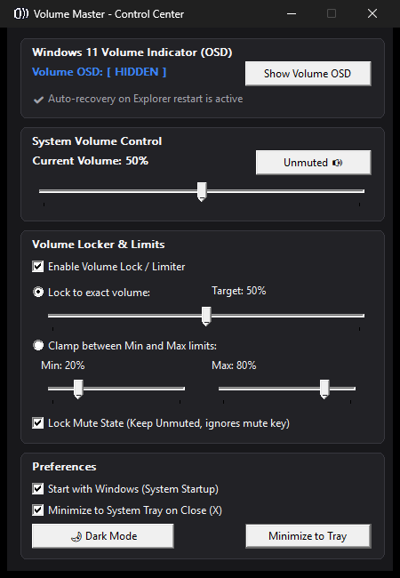
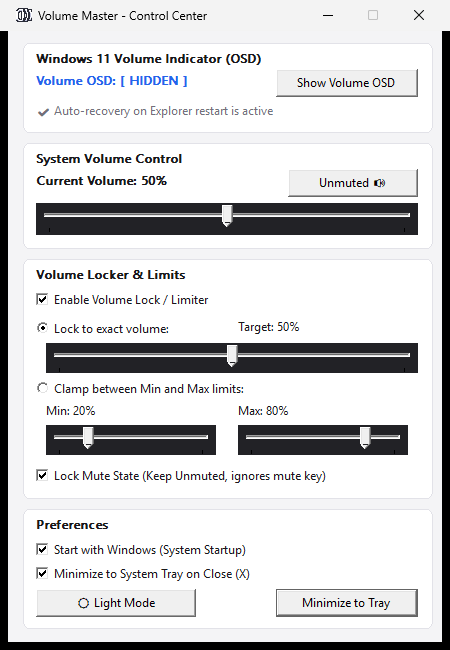

# Volume Master

[English](#english) | [Русский](#russian)

---

<a name="russian"></a>
## Русский

**Volume Master** — ультралегковесное нативное приложение для Windows 11 и 10, написанное на Rust. Оно объединяет функции скрытия системного индикатора громкости (OSD) и гибкой блокировки уровня звука.

### 📸 Скриншоты

| Темная тема (Dark) | Светлая тема (Light) |
| :---: | :---: |
|  |  |

---

### ✨ Возможности

1. **Скрытие всплывающего индикатора громкости (Windows 11 / 10 OSD):**
   - Полное подавление системного баннера громкости.
   - **Авто-восстановление при перезапуске Проводника (`explorer.exe`)**: приложение отслеживает событие `TaskbarCreated` и встроенный таймер. Если Explorer перезапускается, окно индикатора повторно перехватывается и скрывается автоматически.
   - Возможность в любой момент показать или скрыть OSD одной кнопкой.

2. **Блокировщик громкости и ограничения (Volume Locker & Limiter):**
   - Защита от периферии (например, клавиатур или гарнитур, где кнопка Mute сбивает уровень громкости).
   - **Режим точной фиксации (Exact):** удерживает громкость на выбранном проценте.
   - **Режим диапазона (Range):** задает минимальный и максимальный порог громкости (Min / Max).
   - **Фиксация Mute (Keep Unmuted):** запрещает внешнее отключение звука.

3. **Интерфейс и темы:**
   - Стильный минималистичный интерфейс на чистом Win32 GDI без тяжелых фреймворков.
   - Поддержка темной (Dark) и светлой (Light) тем с сохранением выбора.
   - Авторская пиксель-арт иконка (16x16) с контурной адаптацией для четкого отображения на любом фоне.

4. **Системный трей:**
   - Быстрый доступ к переключателям OSD, Lock, темам и автозагрузке.
   - Сворачивание по нажатию на крестик.

5. **Производительность:**
   - Потребление памяти: ~2.5 МБ RAM (Working Set ~18 МБ).
   - Размер сборки: ~340 КБ.
   - 0% нагрузки на процессор в фоновом режиме.

---

### 📦 Сборка и установка

Требуется установленный Rust (toolchain `stable-x86_64-pc-windows-gnu`):

```bash
cargo build --release
```

Готовый исполняемый файл будет доступен по пути:
`target/release/volume-master.exe`

Настройки сохраняются в:
`%APPDATA%\VolumeMaster\config.json`

---

<a name="english"></a>
## English

**Volume Master** is an ultra-lightweight native Windows 11 & 10 utility written in Rust. It combines Windows Volume OSD suppression with volume locking and limit controls.

### ✨ Features

1. **Volume OSD Suppressor:**
   - Completely hides the native Windows 11 & 10 volume flyout.
   - **Explorer restart auto-recovery:** listens to `TaskbarCreated` messages and runs health-checks to ensure the OSD remains hidden even after `explorer.exe` crashes or restarts.
   - Toggle OSD visibility at any time with one click.

2. **Volume Locker & Limits:**
   - Prevents hardware keys or rogue apps from altering your audio level.
   - **Exact Lock Mode:** locks system volume to a precise percentage.
   - **Range Mode:** clamps volume between defined Min and Max thresholds.
   - **Lock Mute State:** prevents unwanted mute toggles.

3. **Modern Minimalist UI & Themes:**
   - Native Win32 GDI design without web engines or heavy runtimes.
   - Built-in Dark and Light themes with persistent configuration.
   - Custom pixel-art icon rendered with high-contrast outlines for both dark and light taskbars.

4. **Resource Efficiency:**
   - Memory footprint: ~2.5 MB private RAM (~18 MB working set).
   - Executable size: ~340 KB.
   - Event-driven COM audio callbacks with virtually 0% background CPU usage.

---

### 🛠️ Building from Source

Ensure the Rust toolchain (`stable-x86_64-pc-windows-gnu`) is installed:

```bash
cargo build --release
```

The output binary will be located at:
`target/release/volume-master.exe`
